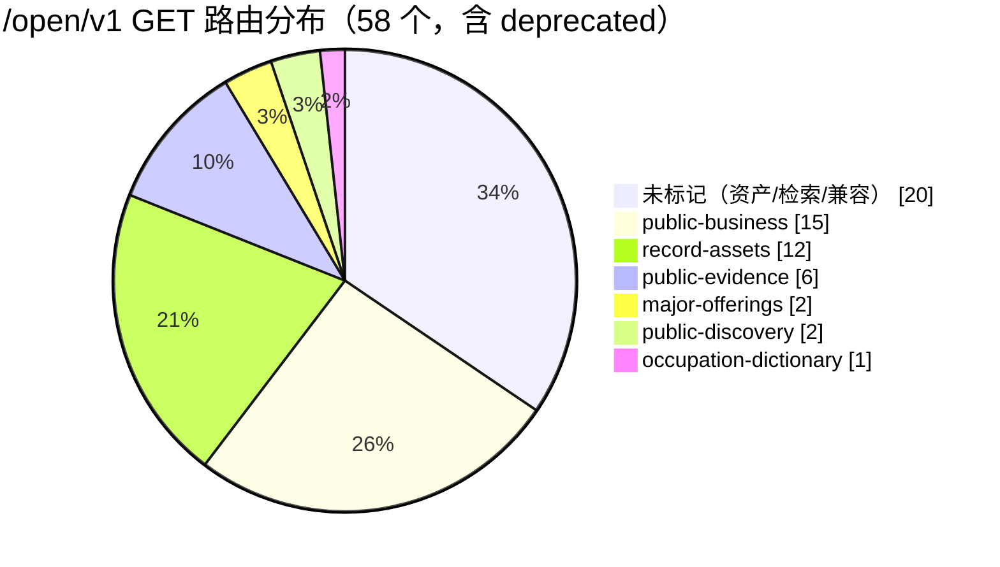

# Open API 检索性能验收报告

**实测时间**：2026-11-16 15:10（Asia/Shanghai）  
**目标环境**：`http://10.100.11.51:8000`，通过 `.env.dev` 的 `BUILDIN_API_CALLER` 注入 API Key；密钥未写入输出。  
**测试性质**：只读 GET、固定列表/聚合语料；不启动 Worker 或采集调度。

本轮对当前公开 OpenAPI 先做静态盘点，再对活跃列表/聚合入口做固定负载。当前 OpenAPI 有 58 个公开 GET 路由，其中 50 个活跃、8 个 deprecated；完整清单见 [`open_api_query_inventory_2026-11-16.json`](../testing/artifacts/open_api_query_inventory_2026-11-16.json)。

## 活跃列表/聚合基线

每个端点 20 次、并发 4、超时 10 秒，共 160 次请求。所有请求都使用 API Caller 认证，状态码为 200，无传输错误；总耗时 1.746 秒，吞吐量 91.62 RPS。脱敏原始统计见 [`open_api_query_perf_active_2026-11-16.json`](../testing/artifacts/open_api_query_perf_active_2026-11-16.json)。

| 端点 | 样本 | 成功 | P50 ms | P95 ms | P99 ms | 观察 |
| --- | ---: | ---: | ---: | ---: | ---: | --- |
| `/open/v1/assets` | 20 | 20 | 73.294 | 162.189 | 165.401 | 本轮低于 200 ms 目标 |
| `/open/v1/major-profiles` | 20 | 20 | 14.951 | 30.379 | 32.425 | 正常 |
| `/open/v1/talent-training-plans` | 20 | 20 | 51.540 | 97.544 | 100.862 | 正常 |
| `/open/v1/major-offerings/aggregate` | 20 | 20 | 18.399 | 43.666 | 49.445 | 正常 |
| `/open/v1/major-courses/aggregate` | 20 | 20 | 53.663 | 259.148 | 263.668 | P95 高于 200 ms，需后续专项分析 |
| `/open/v1/record-assets/ability-analyses` | 20 | 20 | 12.836 | 23.300 | 25.164 | 正常 |
| `/open/v1/record-assets/job-demand-records` | 20 | 20 | 34.532 | 76.273 | 79.155 | 正常 |
| `/open/v1/record-assets/job-demand-records/aggregate` | 20 | 20 | 21.301 | 30.958 | 31.850 | 正常 |

本轮 `/open/v1/assets` P95 为 162.189 ms，低于 2026-08-27 报告中的 316.574 ms；两次环境数据和并发条件并非完全相同，因此只能作为趋势观察，不能宣称严格 A/B 因果结论。`major-courses/aggregate` 的 P95 为 259.148 ms，是当前活跃基线中需要优先继续分析的入口。

## 覆盖边界

本轮性能语料覆盖 8/50 个活跃公开 GET 路由（16.0%），集中在无 ID 依赖的列表和聚合入口。详情、正文、章节、大纲、图谱和证据接口需要真实 asset/ref/chunk/node ID；`search`/`qa` 还需要向量和模型依赖，因此没有用伪造 ID 或空数据把它们标成已验收。8 个 deprecated GET 路由未纳入活跃成功率；单独探针确认它们返回预期 410/兼容错误口径，统计保存在 [`open_api_query_perf_2026-11-16.json`](../testing/artifacts/open_api_query_perf_2026-11-16.json)。

公开 GET 路由按 OpenAPI 标签分布如下：



## 结论与后续

- 活跃列表/聚合入口本轮 160/160 返回 200，认证、传输和基本延迟基线通过。
- `/open/v1/assets` 当前实测 P95 已低于 200 ms；此前已完成的标签复合索引切片应在下一次同数据集复测中单独对照。
- `/open/v1/major-courses/aggregate` P95 超过 200 ms，列入任务 2 的下一性能切片，需结合 PostgreSQL `EXPLAIN (ANALYZE, BUFFERS)` 和同条件 SQL 统计后再决定索引或查询改造。
- 详情/证据/语义检索端点尚未声称通过；需要固定真实 ID、模型依赖和响应预算后再做第二轮全量验收。

可复现命令：

```bash
NEXUS_ENV=development NEXUS_ALLOW_MISSING_RULES=true \
  nexus-api/.venv/bin/python tools/generate_open_api_query_inventory.py \
  --output docs/testing/artifacts/open_api_query_inventory_2026-11-16.json

set -a; source .env.dev; set +a
export NEXUS_OPEN_API_KEY="$BUILDIN_API_CALLER"
nexus-api/.venv/bin/python tools/open_api_query_perf.py \
  --base-url http://10.100.11.51:8000 \
  --requests-per-endpoint 20 --concurrency 4 --timeout-seconds 10 \
  --endpoint asset_catalog --endpoint major_profiles \
  --endpoint training_plans --endpoint major_offerings \
  --endpoint major_courses --endpoint ability_analyses \
  --endpoint job_demand_records --endpoint job_demand_aggregate \
  --output /tmp/open-api-query-perf-active.json
```
